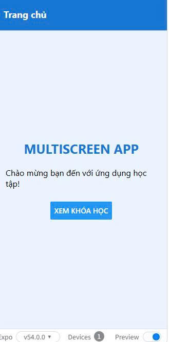
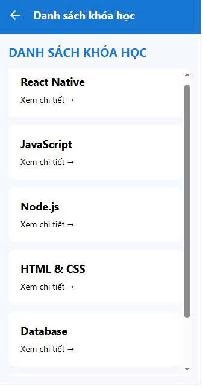
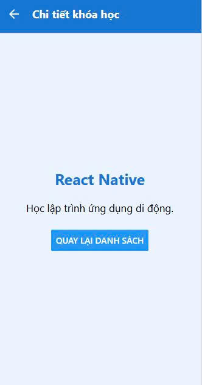

# BAI02 - BT04: MULTISCREENAPP

## 1. Thông tin ứng dụng
- **Tên ứng dụng:** MultiScreenApp
- **Nền tảng:** React Native và Expo Snack
- **Chức năng:** Điều hướng giữa nhiều màn hình bằng Stack Navigation.

## 2. Link ứng dụng Expo
- Link Expo Snack: [(https://snack.expo.dev/@lamminhkhang/multiscreenapp)]

## 3. Các màn hình chính

### HomeScreen – Trang chủ

### ListScreen – Danh sách khóa học

### DetailScreen – Chi tiết khóa học

## 4. Công nghệ sử dụng
- React Native
- Expo Snack
- React Navigation
- Stack Navigation
- FlatList
- TouchableOpacity

## 5. Các thành phần trong ứng dụng
- `App.js`: Cấu hình Stack Navigation.
- `HomeScreen.js`: Giao diện trang chủ.
- `ListScreen.js`: Hiển thị danh sách khóa học.
- `DetailScreen.js`: Hiển thị
