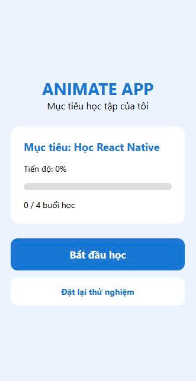
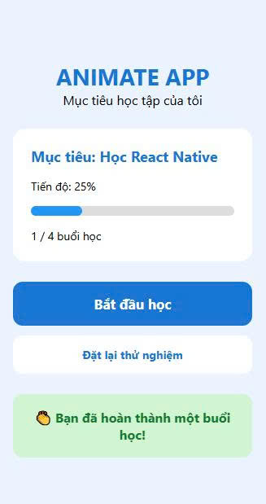
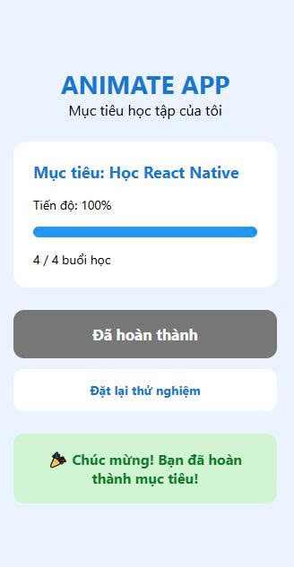

# BAI 05 - ANIMATE APP

## 1. Thông tin ứng dụng
- **Tên ứng dụng:** AnimateApp
- **Chủ đề:** Theo dõi mục tiêu học tập
- **Công nghệ:** React Native, Expo

## 2. Chức năng
- Hiển thị tiến độ học tập.
- Nhấn nút để tăng tiến độ mỗi lần 25%.
- Hiển thị thông báo khi hoàn thành một buổi học.
- Hiệu ứng phóng to và di chuyển thông báo.
- Có nút đặt lại tiến độ.

## 3. Cấu trúc thư mục

```text
Bt05/
├── App.js
├── Readme.md
├── components/
│   ├── ProgressCard.js
│   ├── ActionButton.js
│   └── AnimatedMessage.js
└── visual/
```

## 4. Các thành phần
- **ProgressCard:** Hiển thị mục tiêu và tiến độ học tập.
- **ActionButton:** Nút bắt đầu học.
- **AnimatedMessage:** Hiển thị thông báo có hiệu ứng animation.

## 5. Hình ảnh giao diện

### Giao diện chính


### Hiệu ứng animation


### Hoàn thành mục tiêu


## 6. Liên kết Expo
[(https://snack.expo.dev/@lamminhkhang/animateapp)]

## 7. Kết luận
Ứng dụng AnimateApp giúp theo dõi tiến độ học tập và tìm hiểu cách sử dụng Animated trong React Native.
