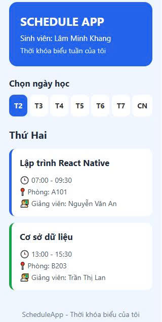
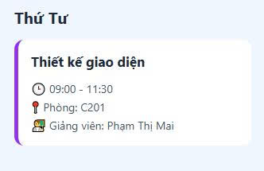
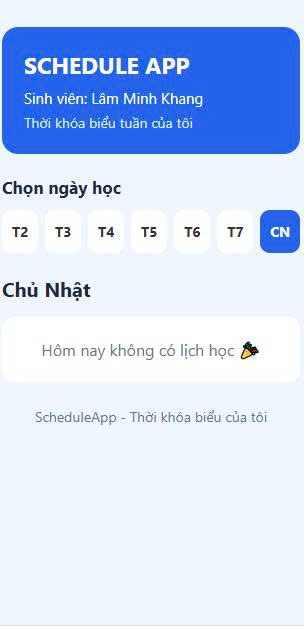

# BAI 06 - SCHEDULE APP

## 1. Thông tin ứng dụng

- **Tên ứng dụng:** ScheduleApp
- **Sinh viên:** Lâm Minh Khang
- **Lớp:** CNTT18A
- **Công nghệ:** React Native, Expo

## 2. Mục tiêu

Xây dựng ứng dụng thời khóa biểu giúp sinh viên theo dõi lịch học theo từng ngày trong tuần.

## 3. Chức năng chính

- Hiển thị tên ứng dụng và thông tin sinh viên.
- Hiển thị 7 ngày trong tuần theo hàng ngang.
- Cho phép chọn ngày để xem lịch học tương ứng.
- Hiển thị tên môn học, phòng học, giờ học và giảng viên.
- Sử dụng màu sắc khác nhau để phân biệt các môn học.
- Hiển thị thông báo khi ngày được chọn không có lịch học.

## 4. Cấu trúc thư mục

```text
Bt06/
├── App.js
├── Readme.md
├── components/
│   ├── Header.js
│   ├── WeekDays.js
│   └── ScheduleList.js
└── visual/
    ├── giaodien.jpg
    ├── lichhoc.jpg
    └── khongcolich.jpg
```

## 5. Các Component

| Component | Chức năng |
|---|---|
| Header.js | Hiển thị tên ứng dụng và sinh viên |
| WeekDays.js | Hiển thị và chọn 7 ngày trong tuần |
| ScheduleList.js | Hiển thị lịch học theo ngày |
| App.js | Kết nối và quản lý các component |

## 6. Hình ảnh giao diện

### Giao diện chính


### Danh sách lịch học


### Ngày không có lịch học


## 7. Link ứng dụng Expo

[(https://snack.expo.dev/@lamminhkhang/scheduleapp)]


## 8. Kết luận

Hoàn thành ứng dụng ScheduleApp bằng React Native. Ứng dụng hỗ trợ xem lịch học theo từng ngày, thay đổi ngày linh hoạt và hiển thị thông tin môn học rõ ràng, dễ sử dụng.
