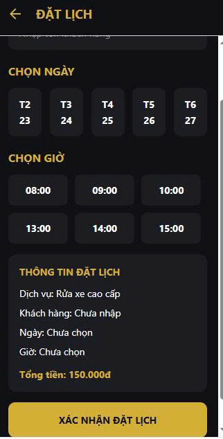
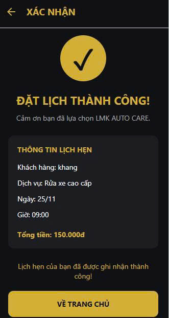

# BAI 07 - BOOKING APP

## 1. Giới thiệu

BookingApp là ứng dụng đặt lịch chăm sóc xe được xây dựng bằng React Native và Expo.

Ứng dụng mang tên **LMK AUTO CARE**, hỗ trợ khách hàng lựa chọn dịch vụ và đặt lịch trực tuyến.

## 2. Link chạy ứng dụng Expo Snack

[(https://snack.expo.dev/@lamminhkhang/bookingapp)]

## 3. Chức năng chính

- Hiển thị danh sách dịch vụ chăm sóc xe.
- Xem thông tin chi tiết từng dịch vụ.
- Nhập tên khách hàng.
- Chọn ngày và giờ đặt lịch.
- Hiển thị thông tin đặt lịch.
- Xác nhận đặt lịch thành công.
- Quay về trang chủ sau khi hoàn tất.

## 4. Công nghệ sử dụng

- React Native
- Expo
- React Navigation
- JavaScript

## 5. Cấu trúc thư mục

```text
Bt07/
├── App.js
├── readme.md
├── components/
│   ├── ServiceCard.js
│   ├── DateSelector.js
│   ├── TimeSlot.js
│   └── BookingSummary.js
├── screens/
│   ├── HomeScreen.js
│   ├── ServiceDetailScreen.js
│   ├── BookingScreen.js
│   └── ConfirmationScreen.js
└── image/
    ├── Bai02.bt07.1.jpg
    ├── Bai02.bt07.2.jpg
    ├── Bai02.bt07.3.jpg
    └── Bai02.bt07.4.jpg
```

## 6. Mô tả các màn hình

- **HomeScreen:** Hiển thị trang chủ và danh sách dịch vụ chăm sóc xe.
- **ServiceDetailScreen:** Hiển thị thông tin chi tiết dịch vụ.
- **BookingScreen:** Nhập tên khách hàng, chọn ngày và giờ đặt lịch.
- **ConfirmationScreen:** Hiển thị thông tin và thông báo đặt lịch thành công.

## 7. Mô tả các Component

- **ServiceCard:** Hiển thị hình ảnh, tên, thời gian và giá dịch vụ.
- **DateSelector:** Cho phép khách hàng chọn ngày đặt lịch.
- **TimeSlot:** Cho phép khách hàng chọn khung giờ.
- **BookingSummary:** Hiển thị thông tin đặt lịch đã chọn.

## 8. Kiến thức áp dụng

- Stack Navigation.
- Truyền dữ liệu bằng Route Params.
- Sử dụng Props.
- Sử dụng useState.
- Sử dụng TextInput và Pressable.
- Xử lý sự kiện và điều hướng giữa các màn hình.

## 9. Hình ảnh minh họa giao diện

### Hình ảnh 1


### Hình ảnh 2


### Hình ảnh 3



### Hình ảnh 4



## 10. Thông tin sinh viên

- **Họ và tên:** Lâm Minh Khang
- **Lớp:** CNTT18A
- **Trường:** Cao đẳng Kỹ thuật Công nghệ Nha Trang
- **Bài tập:** Bai02 - Bt07

## 11. Kết luận

Ứng dụng BookingApp giúp vận dụng kiến thức React Native để xây dựng ứng dụng nhiều màn hình, quản lý dữ liệu và thực hiện chức năng đặt lịch chăm sóc xe cơ bản.